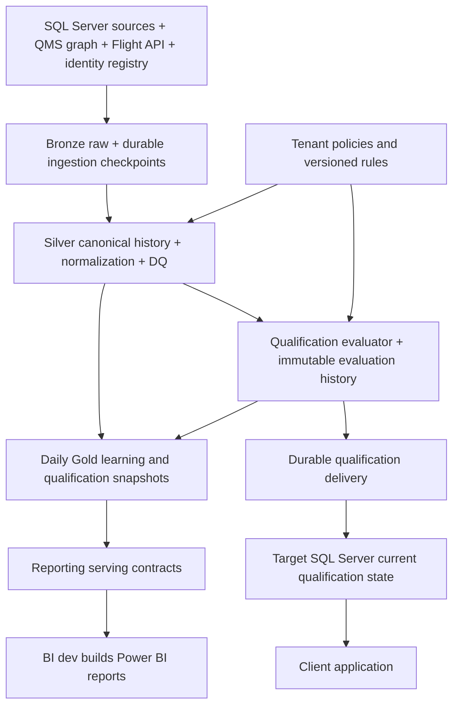

# ARCHITECTURE — Proposed bootstrap

Ngày baseline: 2026-11-17; cập nhật 2026-11-18. Full business design vẫn **PROPOSED**;
DevOps slice có code/IaC/tests trong repo, AWS deployment chưa kiểm chứng. AWS single-platform direction là ACCEPTED; service list chưa chốt.
Repository boundaries: [AWS blueprint](../architecture/aws-platform.md);
quyết định: [ADR 0001](../adr/0001-single-aws-platform.md).
Business scope đã ACCEPTED nằm trong [BUSINESS_RULES.md](BUSINESS_RULES.md).

## 1. System boundaries

| Boundary | Trách nhiệm |
|---|---|
| Upstream/mockgen repo | Source fixtures/scenarios/reference outputs; pin contract/commit để kiểm thử |
| Platform repo này | Ingestion, normalization/DQ, evaluation, daily BI serving, SQL backfeed, governance/observability/CI/CD/IaC |
| BI developer | Power BI semantic model, DAX, visuals, reports/refresh phối hợp với data serving |
| Client application | Đọc target SQL qualification status theo contract; app code không thuộc phạm vi platform mặc định |

Không copy generator source vào business engine của platform. Đọc source inputs
qua artifacts hoặc source SQL/graph/API integration; derived upstream outputs
để validation riêng. Không tự publish hoặc migrate source/target databases.

## 2. Proposed tenant data plane

Diagram áp dụng **bên trong một hãng**; instantiate theo tenant, không join chéo
data planes. Backfeed đi từ validated current evaluation, không qua daily Gold.
Expiry/rolling-window/time triggers cũng có thể yêu cầu evaluation khi không CDC.
Reporting có cutoff/as-of/source coverage và publication ID riêng.

Tenant silo là baseline đề xuất: storage/DB/graph, security principals và lifecycle
riêng; strict tier còn tách account/workspace/compute/network theo yêu cầu khách.
Không gọi database/schema separation là dedicated physical hardware. Shared code/
IaC/config templates khác shared business data. Control plane chỉ giữ metadata
được phép; policies, raw payloads, checkpoints, logs có data và backups nằm trong
tenant boundary. Tenant routing lấy từ trusted config/auth binding.

## 3. Logical module responsibilities — chưa phải folder structure bắt buộc

| Module/concern | Input → output / ownership |
|---|---|
| Source connectors | Tenant-bound SQL/graph/API/artifact extraction → raw/checkpoints; pagination, retries, change discovery |
| Canonicalization/DQ | Raw + contracts/metadata/registry → typed canonical history/current records, issues/quarantine |
| Identity/assignments | TMDS/registry/role mappings → tenant-local identities và required targets/qualifications |
| Qualification evaluation | Canonical evidence + rule snapshot + explicit as-of → immutable evaluation/results/evidence refs |
| Custom policies | Tenant-specific selectors/mappings, employmentdate-to-seniority → versioned derived results |
| Daily reporting | Canonical learning + selected evaluations/dimensions → coherent daily serving publication |
| Operational delivery | Current authoritative evaluation → durable intents/SQL upsert/ack/attempt audit/reconciliation |
| Governance/security | Contracts, ownership, lineage, secrets refs, access policies, retention/isolation checks |
| Operations/delivery tooling | Orchestration, metrics/alerts/runbooks, IaC plans/deployments, CI/CD và recovery |

Giữ business logic độc lập với engine/I/O khi hợp lý. Không tạo framework/plugin
architecture hay services trước khi một vertical slice chứng minh nhu cầu.
AWS đã chọn; chọn services/runtime sau khi xác minh environment/budget; cấu trúc repo/dependencies
phải dựa vào manifests/source hiện có, không coi bảng này là code đã tồn tại.

## 4. Data model direction

| Layer/product | Grain/key và nguyên tắc |
|---|---|
| Bronze | Source row image/event/delivery/snapshot + tenant/source/batch/ref; raw immutable, event/ingestion times tách biệt |
| Silver | Tenant-local canonical entities/history; employee/role assignments, Flight revisions, LMS enrollments/exam attempts, ETR attempts/sections/items, QMS rule graph |
| Evaluation history | Tenant × pilot × qualification × evaluation ID, input hash/checkpoints, rule version/snapshot, as-of và per-key sequence |
| Gold dimensions | Employee SCD2, org/location, role, course/exam/template, qualification-rule, seniority band/policy và date/status |
| Gold facts/bridges | Flight, exam/assessment attempts, enrollment, daily learning/qualification snapshots; role/evidence bridges giữ grain riêng |
| Seniority snapshot | Tenant × user × as-of date/publication + employmentdate version/policy; không static trong employee dimension |
| Reporting serving | Pilot learning targets/detail và pilot qualification status/gaps theo daily publication, có dictionary/relationships/security/freshness |
| Target SQL current state | Tenant-bound client pilot ID × qualification; status, evaluation/as-of, sequence/provenance và agreed lifecycle/technical metadata |

Star schema ưu tiên cho Gold/BI; normalized Silver bảo toàn relationships/history.
Snowflake schema chỉ dùng chọn lọc cho hierarchy có lợi ích rõ; không bắt buộc
mọi dimension chuẩn hóa. Data marts hỗ trợ hai reports chính, không tự mở phạm vi
thành nhiều reports khác. Data mesh là domain ownership/product contracts/self-
service/governance, không thay thế tenant isolation hay dimensional modeling.

Business/surrogate keys luôn có tenant context. SCD2 validity [from,to) không
overlap; observed history không tự biến thành source-effective history. Facts
giữ measures đúng grain, tránh nhân Flight totals qua roles/items/evidence joins.

## 5. Publication, state và failure boundaries

### Daily reporting

Stage → validate/reconcile → switch report publication coherently. Manifest lưu
report date/cutoff/as-of, source checkpoints, rule/mapping versions, coverage/DQ
và ready time. Giữ historical publications; corrected rerun tạo version mới.
Cutoff/deadline/timezone/calendar/late-source handling cần chốt với người dùng.
BI refresh/gateway/Import-vs-DirectQuery là integration decision chưa chọn.

### Operational qualification backfeed

Reevaluate impacted keys → persist evaluation + durable delivery intent → target
SQL transaction → ack/checkpoint. Nếu dùng outbox, chỉ hứa atomicity khi các writes
thực sự cùng transaction/store. Lakehouse + SQL không tự có distributed transaction;
thiết kế replayable checkpoints/reconciliation và test crash windows.

Target contract phải có explicit app identity và authoritative per-key state
ordering. Stale delivery bị chặn atomically; replay cùng delivery là idempotent;
commit xong/lost ack phải recover. Backlog/attempts có audit và tenant ownership.
Numeric latency SLO, enums, client edits/write authority và lifecycle/error/stale
handling là OPEN. Không tự giữ stale QUALIFIED làm current sau uncertainty.

### Shared semantics, independent operations

Reporting job failure không mặc nhiên block current backfeed; target outage
không làm mất valid canonical/reporting data. Tách schedules/checkpoints/retries/
resource budgets theo workload. Có thể share compute chỉ khi tenant cho phép và
tests đo được contention. Reconcile hai nhánh ở cùng checkpoint/rules/as-of.
Historical analytics backfill không upsert historical states vào app current.

## 6. Observability và verification direction

- Reporting: on-time/late/missing daily publications, completeness/DQ, serving
  query/contract checks; DE ready time tách Power BI display timing.
- Backfeed: source availability/detection/evaluation/queue/SQL commit visibility,
  p50/p95/p99/max, queue depth/oldest pending, retry/stale keys và reconciliation.
- Không fabricate source latency nếu source không cung cấp timestamps; ghi rõ
  điểm bắt đầu đo thay thế. Job duration không thay thế end-to-end latency.
- Tests: tenant collisions/negative access, null/type/DQ, expected learning targets,
  qualification semantics, date/anniversary bands, replay/late/correction/delete,
  daily consistency, stale delivery và target-outage/crash recovery.
- IaC/CI/CD có reviewable plans, test environments, pinned artifacts/config/rules,
  release provenance và runbooks. Default checks không cần production hoặc cloud
  resources trả phí. Code rollback và data recovery là hai quy trình riêng.

## 7. Open architecture decisions

AWS services/account/Region/budget, source discovery/CDC/polling, orchestration, storage formats,
evaluation engine, physical data schemas, target SQL integration, isolation tier,
retention/scale/budget và operational SLO chưa chốt. ADR chỉ ghi ACCEPTED khi có
quyết định thực tế. Khi có implementation, thêm module paths/commands/evidence
đã kiểm chứng; không dùng diagram trên để khẳng định deployment tồn tại.

## 8. DevOps milestone — IMPLEMENTED repo code, AWS UNVERIFIED

Theo user scope ngày 2026-11-18, tạm dùng một synthetic SQL Server test table →
bounded full snapshot → raw/DQ/mapping/filter → S3 JSONL/manifest. Python 3.12 Lambda,
Step Functions/Scheduler, tenant S3/KMS/Secrets/IAM/network endpoints, Glue/Athena và
CloudWatch/SNS/SQS được định nghĩa trong Terraform. Không dùng output này thay hai
BI products hoặc qualification SQL backfeed; các nhánh business đó DEFERRED trong slice.

CodePipeline/CodeBuild có build/plan/approval/apply/verify; bootstrap control plane
state/authority khác platform. Apply exact saved plan với source/artifact/backend/
boundary/TTL checks. Deployment JSON/output contract là seam để thêm AWS CDK; CDK
chưa implement và không dual resource ownership. Terraform CLI/provider/dependencies
được pin/lock. Password ngoài Terraform; owner seed initial remote backend riêng.

Implementation/source contracts và commands: [DevOps guide](../devops/README.md),
[ADR 0002](../adr/0002-devops-terraform-codepipeline.md),
[runbook](../runbooks/devops-lab.md). Service choices của slice không chốt cloud
account/Region/budget/isolation hoặc numeric business SLA. Actual access/network/
SQL integration/recovery cần AWS evidence riêng.

### 2026-11-19 — CodeCommit source

ACCEPTED/IMPLEMENTED: bootstrap dùng existing CodeCommit repository cùng account/Region,
inputs repository_name/branch; source CODE_ZIP và polling, không CodeConnection.
Pipeline IAM giới hạn source actions vào repository ARN. Operator quản lý repository
và push source trước apply. AWS runtime vẫn UNVERIFIED.
