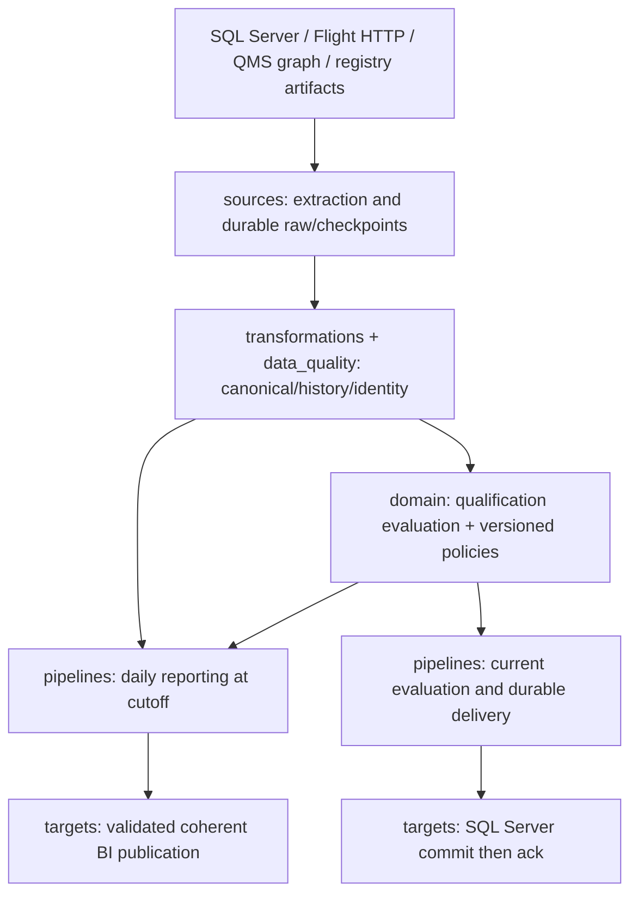

# AWS platform blueprint

Ngày: 2026-11-17. AWS và single-platform repo: ACCEPTED. Cấu trúc, service mapping
và execution design dưới đây: PROPOSED, chưa IMPLEMENTED.

## 1. Data flow và ownership

Diagram áp dụng bên trong từng tenant. Orchestration kích hoạt/điều phối các
pipelines; governance, observability và infrastructure bao phủ toàn bộ flow.
Backfeed không qua daily reporting; historical rerun không ghi app current state.

## 2. Module boundaries

- `sources/`: extraction tới durable raw; không tạo qualification results.
- `transformations/`: deterministic calculations/model definitions; domain APIs
  nhận canonical inputs, rule/policy versions và explicit as-of, không tự gọi SDK.
- `data_quality/`: reusable validators và issue/gate semantics; orchestration
  áp dụng kết quả gate, không viết lại business checks trong workflow.
- `targets/`: serialize/publish/deliver outputs; không tự tính qualification.
- `pipelines/`: application use cases, phối hợp các module, explicit tenant và
  run context, durable progress/publication/delivery boundaries.
- `orchestration/`: schedules/events/dependencies/retries/timeouts/concurrency;
  gọi pipeline entrypoints, không chứa business transformation logic.
- `infra/`: sở hữu resource lifecycle/IAM/network/log destinations; các module
  khác sở hữu job code, workflow definitions, DQ rules, dashboards/log schemas.
  Infra tham chiếu các artifacts đó; không duy trì hai bản khác nhau.
- `ci/`: local/CI check-build-release logic; provider-specific workflow chỉ thêm
  sau khi chọn provider, gọi cùng scripts. Chưa có executable commands.

Khi chọn language, thêm manifests/packaging phù hợp và quy tắc imports. Các
directory responsibilities không bắt buộc một service/process cho mỗi folder.

## 3. AWS service candidates — chưa phải bill of materials

| Concern | Candidate và tiêu chí lựa chọn |
|---|---|
| Raw/curated storage | S3 tenant-bound storage, encryption/version/lifecycle; format chọn sau volume và update patterns |
| Catalog/access | Glue Data Catalog; Lake Formation nếu cần quản lý quyền lake qua supported query paths; vẫn kiểm soát direct S3/IAM access |
| Compute | Lambda cho tác vụ ngắn; ECS/Fargate cho worker cần container/lifecycle dài; Glue cho distributed transformations khi có nhu cầu. Không triển khai cả ba mặc định |
| Workflow/scheduling | Step Functions + EventBridge Scheduler là baseline đề xuất; MWAA chỉ nếu nhu cầu Airflow cụ thể biện minh |
| Analytical serving | Đánh giá Athena trên S3 và/hoặc Redshift theo query model, Power BI connectivity, workload/cost; chưa chọn engine |
| Operational state/delivery | Chọn transactional state store và queue sau khi xác định atomicity, per-key ordering, replay/crash windows; không giả định SQS bảo đảm SQL idempotency |
| SQL ingestion | Connector/polling hoặc DMS sau khi kiểm chứng SQL Server CDC capabilities, permissions và extraction contract |
| SQL target | Giữ SQL Server do client chỉ định; AWS hosting không mặc định biến target thành RDS |
| Secrets/security | IAM, KMS, Secrets Manager; resource bindings qua trusted tenant config |
| Observability/audit | CloudWatch metrics/logs/alarms; CloudTrail cho AWS API audit, không thay thế business/data delivery audit |

AWS docs đã đối chiếu để xác nhận capabilities, không phải deployment evidence:

- [Step Functions integration patterns](https://docs.aws.amazon.com/step-functions/latest/dg/connect-to-resource.html)
- [Lake Formation](https://docs.aws.amazon.com/lake-formation/latest/dg/what-is-lake-formation.html)
- [CloudWatch cross-account observability](https://docs.aws.amazon.com/AmazonCloudWatch/latest/monitoring/CloudWatch-Unified-Cross-Account-Setup.html)
- [CloudWatch Logs sensitive data protection](https://docs.aws.amazon.com/AmazonCloudWatch/latest/logs/mask-sensitive-data.html)

## 4. Tenant isolation và central logging

Isolation tier cần xác nhận trước resource design. Tenant data plane bao gồm raw,
canonical/Gold, graph/policy contents, state/checkpoints, delivery backlog, DQ,
temp/spill, data-bearing logs, BI caches/extracts, exports và backups. RLS hoặc
prefix/schema separation không tự đáp ứng yêu cầu lưu trữ tách biệt.

Central logging có nghĩa chuẩn logging và operational view thống nhất. Business
payloads/PII/custom rules không mặc định được copy sang shared log store. Logs có
data giữ ở tenant boundary. Cross-account visibility hoặc replication chỉ bật
với allowlist fields, authorized roles, retention và tenant approval tương ứng;
federated visibility vẫn là quyền truy cập data cần kiểm soát.

Shared control plane chỉ nhận metadata được phép. Log context đề xuất gồm opaque
correlation/run IDs, stage, safe error code và release/version; không log secret,
connection URL, raw payload hoặc pilot identity. Tenant reference chỉ dùng nếu
được phép. Redact trước emission; masking downstream không thay thế boundary.

## 5. Delivery, monitoring và recovery

- Raw checkpoint chỉ advance khi raw bền vững; evaluation và pending delivery
  cần durable coordination/reconciliation. Atomic outbox chỉ tuyên bố khi writes
  cùng transaction/store; không giả định lake + queue + SQL là atomic.
- Sink idempotent, authoritative per-key ordering và stale-state check trong
  target transaction; ack sau commit, recover khi mất ack. Concurrent-writer
  guarantee chỉ xét khi có conflict policy và tests.
- Daily publication: stage → DQ/reconcile → coherent publication; manifest gồm
  source cutoff/checkpoints, evaluation as-of, rule/mapping versions, coverage.
- Metrics tách job, DQ, business và delivery state. Reporting đo ready deadline;
  backfeed đo source availability/detection/evaluation/queue/commit visibility,
  p50/p95/p99/max, oldest pending và stale keys. Numeric SLA vẫn OPEN.
- SQL outage giữ backlog; reporting failure không block current backfeed.
  Recovery/cleanup có tenant scope và negative tests; code rollback khác backfill.

## 6. Implementation milestones và acceptance

1. Pin upstream source artifacts/contract; define canonical/reporting/target
   contracts, grains/keys/types/owners và independent expected outcomes cho hai
   synthetic tenants IDs trùng. Runtime/language chọn ở bước này.
2. Local artifact vertical slice: raw/history/DQ → qualification → hai daily
   serving products + fake delivery sink. Test explicit clock, replay,
   correction/tombstone, time-triggered expiry và historical rerun boundaries.
3. Review AWS account/Region/budget/isolation, compute/state/serving và IaC plan.
   Build resources chỉ trong authorization; dùng SQL Server test để kiểm chứng
   target transaction, out-of-order delivery, lost ack/outage/recovery thực tế.
4. Integration sources, access controls, central operational view, dashboards,
   alert test sink, CI/CD và runbooks; measure latency trước numeric SLO.

Trace requirements AT-01..26 vào test evidence theo phạm vi. Không báo platform
hoàn thành khi chỉ có scaffold, fake sink hoặc chưa test access/recovery.
