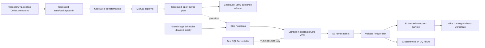

# DevOps slice architecture

## Hai workflows khác nhau

Lambda thực hiện raw/transform/load trong một process để business slice nhỏ.
Responsibilities vẫn tách trong `sources`, `transformations`, `pipelines`, `targets`.
Không cần Glue Spark, EMR, MWAA hoặc Kafka để đổi tên bốn cột.

## Service inventory và ownership

| Concern | Implementation | Ownership / failure boundary |
|---|---|---|
| Source | Existing SQL Server test table | Không tạo RDS/SQL login; source owner cấp SELECT/TLS/connectivity |
| Extraction/compute | Lambda 3.12, published version/live alias | Timeout 180s, max_rows, concurrency=1; workload lớn chuyển worker sau benchmark |
| Storage | Dedicated S3 bucket per tenant, versioning, KMS, TLS-only, no public access | Raw/curated/quarantine/manifests/query-results có prefixes riêng; không mặc định physical hardware isolation |
| Orchestration | Step Functions Standard | Execution name là run_id; service retries; failures cần investigation/redrive |
| Scheduling | EventBridge Scheduler + encrypted SQS DLQ | Schedule disabled mặc định; DLQ chỉ cho failure khi dispatch, không cho mọi Lambda/business failure |
| Secrets | Secrets Manager metadata + tenant KMS | Secret version nhập ngoài Terraform để password không vào state |
| Networking | Existing VPC/private subnets/routes; worker/endpoint SG; S3 gateway + Secrets interface endpoints | Không tạo NAT/VPC mới; không tự sửa SQL firewall hoặc source SG |
| DQ | Python validators, quarantine, manifest gate | Contract/type/PK/date errors block publication, không silent repair |
| Serving/catalog | Glue explicit schema, Athena encrypted workgroup | Injected run_id partition để tránh cộng nhiều snapshots; không cần crawler cho schema đã biết |
| Access/governance | IAM runtime boundary + per-role policies, analytics policy chưa attach | Catalog parameters có owner/classification/version; chưa là enterprise governance program/Lake Formation enforcement |
| Monitoring | CloudWatch dashboard, Lambda/workflow/DLQ alarms, SNS topic | Chưa có human subscription; alarm delivery drill cần authorized test sink |
| Logging | Encrypted tenant-specific CloudWatch log groups | Central naming/context; không ship payloads/PII vào shared data store |
| Audit | Optional management-event CloudTrail trong bootstrap hoặc existing account/org trail | Optional trail yêu cầu dedicated lab account được xác nhận; không bật duplicate trail mặc định; không có S3 data-event audit mặc định |
| CI/CD | CodePipeline V2 queued + 4 CodeBuild roles | Build không deploy; plan chỉ refresh/lock; apply có scoped mutation; verify chỉ read metadata |
| State/artifacts | Separate versioned encrypted S3 state/artifact buckets | Lock S3 native; artifacts expiry 7 ngày; saved plan TTL 24h; state không auto-expire |

Resource ownership: `infra/terraform/bootstrap` là control plane do bootstrap
operator quản lý riêng; pipeline chỉ apply `infra/terraform/platform`. Controller
IAM không nằm trong mutation scope của apply role. Không để pipeline tự nâng
quyền controller bằng một platform plan.

## Correctness và isolation

Contract: [pilot snapshot v1](../../contracts/devops/pilot-snapshot.md). Source là
`devops.pilot_source` synthetic lab table; không giả định schema TMDS upstream.
Full snapshot, một SELECT với source isolation hiện có; không CDC/watermark và
không cam kết coherent snapshot xuyên bảng.

`Binding` chứa tenant, source schema/table, release, max_rows. Source secret phải
cùng tenant; event chỉ có run_id. Writer không nhận tenant/bucket từ source row.
S3 objects conditional-create, cùng key khác bytes là conflict. Manifest viết
cuối cùng; nếu crash trước manifest, retry dùng raw đã commit. Không có distributed
transaction SQL↔S3. Snapshot vượt max_rows fail, không xuất một tập bị cắt ngầm.

Athena không tự kiểm manifest. Consumer phải lấy successful run trước rồi query
đúng run_id; dữ liệu staged mà chưa có manifest không được coi là published.
Bucket/prefix riêng trong shared account là resource-level isolation cho lab,
chưa đáp ứng strict account/network/admin isolation. Negative AWS access tests
và tier của từng hãng vẫn là điều kiện trước production/customer acceptance.

## Security/cost trade-offs

- Interface endpoint, KMS, CloudWatch dashboard/logs, CodeBuild/CodePipeline và
  storage có thể tính phí dù business logic nhỏ; cần budget trước apply.
- Worker không ingress, egress SQL CIDR/port + S3 prefix-list + Secrets endpoint
  SG; source route/DNS/TLS và SQL SG phải được owner xác nhận.
- Existing S3/Secrets VPC endpoints có thể conflict với definitions mới; quyết
  định import/reuse trước plan, không tạo duplicate hoặc sửa route ngoài scope.
- Deploy role có regional EC2 provisioning permissions rộng hơn runtime. Đây là
  review point cho lab account; chưa chứng minh least privilege trong mọi org.
- No data-bearing central logs. Step Functions không log execution payloads;
  handler chỉ log safe error codes/counts và request IDs, không traceback SQL.

## Tài liệu AWS đã đối chiếu

- [Lambda ZIP dependencies](https://docs.aws.amazon.com/lambda/latest/dg/python-package.html)
- [Step Functions Lambda integration](https://docs.aws.amazon.com/step-functions/latest/dg/connect-lambda.html)
- [CodeBuild Python runtimes](https://docs.aws.amazon.com/codebuild/latest/userguide/available-runtimes.html)
- [CodePipeline Terraform reference architecture](https://github.com/aws-samples/terraform-aws-pipeline)
- [SQL driver TLS](https://github.com/denisenkom/pytds)
