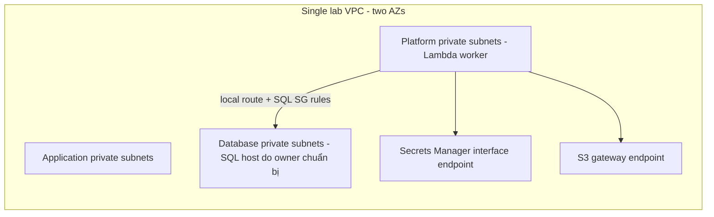

# Lab một VPC: application, database và data platform

IMPLEMENTED IaC, AWS deployment/SQL connectivity UNVERIFIED. Một network owner
quản lý application/source SQL và platform trong cùng account/Region. Đây là lab
một tenant, không phải network riêng của hãng và provider độc lập. Tenant storage,
logs, backups và quyền quản trị vẫn cần isolation contract riêng khi mở rộng.



## Resources và ownership

Root `infra/terraform/network` do operator quản lý, state key
network/<deployment>/terraform.tfstate. Tạo:

- Một VPC có DNS support/hostnames, owner chọn canonical IPv4 /16.
- Application/database/platform: mỗi group hai /24 private subnets, mỗi AZ một
  subnet; mỗi subnet có route table và explicit association riêng.
- Database SQL security group chỉ TCP sql_port từ platform subnet CIDRs. Không
  inbound từ application group mặc định; application là subnet reservation, chưa
  có application compute/SG. Khi thêm app phải review SQL access riêng.
- Không peering, custom inter-subnet routes, NAT, IGW, public IP, SQL/app instance.
  Inter-subnet connectivity dùng VPC local route tự có. Không public IPv4 hoặc
  default route ra Internet; subnet groups không tự ngăn lateral traffic.
- Platform root nhận platform subnet/route IDs, tạo endpoints/worker/SG/storage.
  CI platform không có quyền tạo VPC/subnet. Bootstrap IAM không cần đổi.

SQL SG chỉ là subnet allowlist, chưa là worker-only identity. Hosts khác trong
platform subnets có thể tới SQL port nếu egress cho phép. SQL SG không mở outbound
mới; SG stateful cho response của allowed ingress. Không gắn thêm SG rộng cho SQL
rồi kỳ vọng các SG giới hạn lẫn nhau (allow rules của các SG được cộng lại).

## 1. Configure network và review plan

```bash
cp -n infra/terraform/network/terraform.tfvars.example infra/terraform/network/terraform.tfvars
```

Điền Region/name/tenant khớp bootstrap, hai AZ thật khác nhau trong Region, và
network_cidr /16 không trùng mạng đã có. Ví dụ minh họa, không tự chọn khi apply:

| Group | Reserved range | AZ-A subnet | AZ-B subnet |
|---|---|---|---|
| application | 10.80.0.0/20 | 10.80.0.0/24 | 10.80.1.0/24 |
| database | 10.80.16.0/20 | 10.80.16.0/24 | 10.80.17.0/24 |
| platform | 10.80.32.0/20 | 10.80.32.0/24 | 10.80.33.0/24 |

```bash
export AWS_PROFILE=atdp-terraform
aws sts get-caller-identity
/tmp/atdp-tools/terraform -chdir=infra/terraform/network init -backend-config=bucket=YOUR_STATE_BUCKET -backend-config=key=network/atdp-dev-airline-a/terraform.tfstate -backend-config=region=YOUR_REGION -backend-config=kms_key_id=YOUR_CONTROL_KMS_ARN -backend-config=encrypt=true -backend-config=use_lockfile=true
/tmp/atdp-tools/terraform -chdir=infra/terraform/network plan -out=network.tfplan
/tmp/atdp-tools/terraform -chdir=infra/terraform/network show network.tfplan
```

Review scopes/cost/ownership. Khi operator được phép, apply saved plan:

```bash
/tmp/atdp-tools/terraform -chdir=infra/terraform/network apply network.tfplan
/tmp/atdp-tools/terraform -chdir=infra/terraform/network output -json network_contract
```

Network contract **v2**: tenant_id, vpc_id, application_subnet_ids,
database_subnet_ids, database_sql_security_group_id, platform_inputs.
Không còn source_vpc_id/source_subnet_ids/source_sql_security_group_id/peering ID.
Deployment JSON schema vẫn v1: copy riêng platform_inputs vào config/deployment.json,
không copy toàn bộ network output. vpc_id là shared lab VPC, subnet_ids/route_table_ids
CHỈ platform group, sql_cidr là database reserved /20. Có thể thu hẹp sql_cidr về
SQL /32 ổn định trước khi deploy worker nếu phù hợp.

## 2. Configure platform và SQL

Giữ tenant/project/environment/region đúng bootstrap và schedule_enabled=false.
Validate bằng `.venv/bin/python ci/iac.py validate`, seed platform backend nếu chưa
có, commit/push reviewed deployment.json rồi review/approve CI plan như devops-lab.md.
Chưa cần SQL credentials để deploy hạ tầng, nhưng không chạy workflow trước data readiness.

SQL owner tạo TEST host trong database_subnet_ids, gắn database_sql_security_group_id,
không public SQL endpoint. SQL compute/storage KHÔNG do network root tạo. Application
subnets chưa có app; không imply app-to-SQL connection đã được cấu hình.
Không có NAT/management path tự tạo: patching/SSM/admin access phải thiết kế riêng.
Secrets Manager interface endpoint của platform có phí theo usage/time; review trước apply.

Dùng hostname resolve được trong VPC và khớp certificate, cấu hình TLS trust đúng.
Nếu dùng private hosted zone, owner associate vào VPC này. Root không tạo zone/cert/
Resolver endpoints. Không disable TLS để test. Fixture SELECT-only và secret JSON
schema theo devops-lab.md; không credentials trong Terraform/deployment config.

## 3. Acceptance checks trên AWS

1. Có đúng một VPC; tất cả sáu subnets thuộc VPC đó, CIDRs không overlap, hai AZ.
   Platform Lambda/endpoints chỉ dùng platform subnets; SQL chỉ database subnets.
2. Route tables dùng local connectivity; không peering/default Internet route.
3. Worker resolve SQL hostname đúng private IP, TCP SQL/TLS/SELECT pass; fixture
   raw/curated/manifest đúng independent expected results.
4. Diagnostic host được review trong application subnet không truy cập SQL port;
   worker không truy cập port chưa duyệt. Xác minh không SG bổ sung nào mở quyền.
   Thu hồi SQL ingress trong lab rồi workflow fail kỹ thuật, không publish success;
   restore reviewed rules. Mock tests không chứng minh runtime negative access.
5. Lỗi DNS, TCP firewall, TLS và DB login phải phân biệt được. Không phá shared
   network để làm drills. Đặt schedule bật chỉ sau smoke pass.

## 4. Existing two-VPC state và cleanup

Thiết kế two-VPC cũ được SUPERSEDED. Không tái dùng saved plans cũ. Nếu đã deploy
root cũ, single-VPC plan có destructive replacements; KHÔNG apply như update nhỏ.
Giữ state/backups, dừng writers và review source data recovery. Với disposable lab:
checkout code two-VPC cũ để destroy platform rồi source/app compute/storage rồi
network cũ; sau đó chuyển sang code mới, init đúng backend và re-plan. Không state rm
hoặc init key rỗng để che resources. Production cần migration riêng, không destroy.

Thứ tự cleanup: dừng jobs → platform → source/application hosts + storage tạo tay
→ network → bootstrap. Network phải tồn tại cho đến khi Lambda ENIs/endpoints đã xóa.

```bash
/tmp/atdp-tools/terraform -chdir=infra/terraform/network plan -destroy -out=destroy.tfplan
/tmp/atdp-tools/terraform -chdir=infra/terraform/network show destroy.tfplan
/tmp/atdp-tools/terraform -chdir=infra/terraform/network apply destroy.tfplan
/tmp/atdp-tools/terraform -chdir=infra/terraform/network state list
```

Nếu còn ENIs/SQL hosts, inspect dependency và cleanup đúng owner; không xóa state.
Network destroy không tự xóa compute/storage ngoài state. Full checklist và billing:
[cleanup runbook](devops-lab-cleanup.md).
