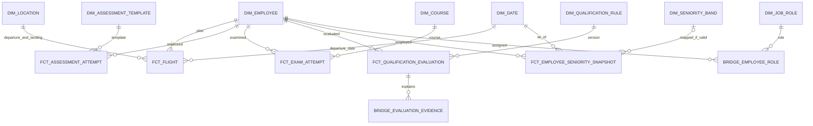

# Data model proposal — Multi-airline Training Platform

Ngày: 2026-11-17 · Trạng thái: **PROPOSED** cho downstream platform.
Input được chấp nhận: nhà cung cấp training phục vụ nhiều hãng; mỗi hãng có
SQL/graph sources và custom mappings riêng; TMDS cung cấp `employmentdate`.
Hai luồng đã ACCEPTED: daily serving cho pilot learning/qualification status
reports trên Power BI (BI dev xây report), và qualification backfeed vào SQL
Server đích với latency càng nhỏ càng tốt, chưa chốt numeric SLO.
Schema nguồn `synthetic-v5` không phải schema warehouse trong tài liệu này.

## 1. Đề xuất chính và vai trò từng pattern

Đề xuất **tenant data plane riêng + canonical history/evaluation dùng chung +
hai read models: daily analytical serving và operational SQL backfeed**.
Dùng một bộ code/IaC templates có cấu hình/version theo hãng. Trong từng hãng,
Silver giữ canonical entities và lịch sử; Gold cung cấp star schemas dùng chung
dimensions cho daily reporting; operational projection ghi current qualification
status vào SQL Server đích mà không chờ full Gold refresh. Áp domain ownership và product contracts phù hợp quy
mô team; không cần dựng một data mesh tổ chức đầy đủ cho bài lab một người.

Các pattern giải quyết những vấn đề khác nhau:

| Pattern | Cách áp dụng trong bài toán | Giới hạn |
|---|---|---|
| Tenant isolation / silo | Tách data, security boundary và lifecycle của hãng | `tenant_id` hoặc RLS trên một bảng chung không đủ cho yêu cầu không lưu chung |
| Medallion | Bronze raw → Silver canonical/history → Gold daily analytics; operational branch dùng validated canonical state | Là cách tổ chức layers; không bắt buộc backfeed đợi daily Gold/reporting |
| Star schema | Gold facts theo business process; dimensions để filter/group | Không join trực tiếp nhiều fact ở grain khác nhau rồi cộng measure |
| Snowflake schema | Chuẩn hóa dimension phân cấp chọn lọc | Không bắt buộc normalize mọi dimension; phân biệt pattern này với sản phẩm Snowflake |
| Data marts | Daily Learning Status và Qualification Status serving; Workforce/Flight hỗ trợ drill-down | BI dev xây Power BI reports; app dùng operational SQL current state riêng |
| Data mesh | Ownership theo domain, contracts, self-service templates, governance chung | Hãng là tenant; TMDS/LMS/ETR/Flight/QMS là domains trong mỗi hãng |

Medallion phân biệt raw, validated và business-ready layers theo [hướng dẫn
Databricks](https://learn.microsoft.com/en-us/azure/databricks/lakehouse/medallion).
Star modeling phân biệt fact/dimension, grain và quản lý lịch sử dimensions theo
[hướng dẫn dimensional modeling của Microsoft](https://learn.microsoft.com/en-us/power-bi/guidance/star-schema).
Quyết định cụ thể dưới đây là đề xuất cho project, không phải kiến trúc đã deploy.

## 2. Storage isolation theo yêu cầu từng hãng

### 2.1. Các lựa chọn

| Mô hình | Dữ liệu lưu ở đâu? | Phù hợp yêu cầu nào? |
|---|---|---|
| Pooled | Tables chung, `tenant_id` + policy/RLS | Chỉ khi khách chấp nhận lưu chung; không phải baseline của bài này |
| Database/storage riêng | SQL DB/graph DB riêng; bucket/container/catalog DB riêng ở downstream | Khi khách chấp nhận shared service infrastructure nhưng cần data objects, grants và backup lifecycle riêng |
| Dedicated tenant data plane | Account/subscription/project hoặc workspace/account service riêng, storage/DB/keys/principals/network/compute riêng | Khi hợp đồng yêu cầu boundary mạnh, bao gồm cả execution và administrative access |

Baseline đề xuất là data plane riêng, với mức account/workspace separation chốt
theo hợp đồng. Separate schema trong một database hoặc folder prefix là logical
segregation; không tự gọi là dedicated storage. Các managed services có thể vẫn
dùng hạ tầng vật lý chung; muốn cam kết dedicated hardware phải xác minh riêng.

Trade-off: isolation mạnh tăng chi phí và số lượng deployment/migration/backup
cần quản lý. Code reuse, IaC modules và contract tests giúp quản lý fleet; không
cần gom dữ liệu để tái sử dụng implementation. Đây là lựa chọn suy ra từ yêu cầu
khách hàng; tham khảo các mức shared/isolated storage trong [Azure Architecture
Center](https://learn.microsoft.com/en-us/azure/architecture/guide/multitenant/approaches/storage-data).

### 2.2. Luồng triển khai

```mermaid
flowchart TB
    CP[Provider control plane: tenant registry, release IDs, routing refs]
    CODE[Shared code and IaC templates]
    subgraph A[Airline A - isolated data plane]
        AS[SQL Server + graph + Flight API + registry]
        AB[Bronze A: raw and checkpoints]
        AP[Versioned custom policies A]
        AV[Silver A: canonical history and DQ]
        AE[Shared qualification evaluation history A]
        AG[Daily Gold A: learning and qualification serving]
        AM[BI dev: Power BI reports A]
        AQ[Durable status delivery A]
        AT[Target SQL Server A: current qualification status]
        AA[Client application A]
        AS --> AB --> AV
        AV --> AG
        AV --> AE
        AE --> AG --> AM
        AE --> AQ --> AT --> AA
        AP --> AV
        AP --> AE
        AP --> AG
    end
    subgraph B[Airline B - isolated data plane]
        BS[SQL Server + graph + Flight API + registry]
        BB[Bronze B: raw and checkpoints]
        BP[Versioned custom policies B]
        BV[Silver B: canonical history and DQ]
        BE[Shared qualification evaluation history B]
        BG[Daily Gold B: learning and qualification serving]
        BM[BI dev: Power BI reports B]
        BQ[Durable status delivery B]
        BT[Target SQL Server B: current qualification status]
        BA[Client application B]
        BS --> BB --> BV
        BV --> BG
        BV --> BE
        BE --> BG --> BM
        BE --> BQ --> BT --> BA
        BP --> BV
        BP --> BE
        BP --> BG
    end
    CODE -. deploy .-> A
    CODE -. deploy .-> B
    CP -. route by trusted tenant context .-> A
    CP -. route by trusted tenant context .-> B
```



Không có mũi tên business data giữa A/B. Shared control plane chỉ lưu tenant
identifier, resource/secret references, release IDs và health status tối thiểu
được cho phép. Không lưu employee/evidence IDs, payload, tenant rule bodies hoặc
custom policy contents; những dữ liệu đó nằm ở data plane tenant. Telemetry chi
tiết, audit có data, BI extracts, spill/temp/cache, backups và DQ cũng nằm trong
cùng boundary; shared telemetry cần redaction và allowlist đã thống nhất.

Mỗi data plane có deny-by-default grants, encryption/key policy, checkpoint
namespace, publication pointer, retention/restore và cleanup riêng. Shared worker
chỉ là tùy chọn nếu tenant chấp nhận; strict tier dùng compute/session riêng.
Không dùng một graph instance/namespace chung để giả định đã đáp ứng yêu cầu
graph database riêng của hãng.
Target SQL databases/read models cũng tuân theo tenant boundary; SQL service
instance có được dùng chung hay không phụ thuộc isolation tier đã chốt. Target
không mặc nhiên là source SQL database và không nhận raw training/Flight tables.

### 2.3. Keys và tenant routing

- Canonical business identity đích: `(tenant_id, source_system, source_id)` hoặc
  `(tenant_id, canonical_pilot_id)`. Không suy ra tenant từ organization/email/ID.
- Mọi table/control record đích mang tenant provenance, dù storage đã tách biệt;
  enforce expected tenant khi đọc/ghi và reject mismatched source binding.
- FK/join trong một silo vẫn kiểm tra tenant; schema có thể dùng composite key
  hoặc constraints tương đương. Surrogate dimension keys chỉ có ý nghĩa trong
  silo; mọi external reference cần tenant context.
- Cùng `TM-000001`, `FLT-000001-0`, `QUAL-1` có thể tồn tại độc lập ở hai hãng.
  Không có global employee master xuyên hãng theo mặc định.
- Registry, policies, graph rules và lookup catalogs của tenant A không fallback
  vào B. Mất hoặc sai routing phải fail closed trước publication.

## 3. Medallion contracts bên trong mỗi tenant

| Layer | Logical tables / đối tượng đề xuất | Grain và trách nhiệm |
|---|---|---|
| Bronze | `raw_tmds_*`, `raw_lms_*`, `raw_etr_*` | Một source row image/change/delivery; giữ raw value và operation |
| Bronze | `raw_flight_delivery`, `raw_qms_snapshot`, `raw_registry_snapshot` | Một delivery hoặc snapshot với source ref/version; duplicate input không bị mất |
| Bronze | `ingestion_batch`, `source_checkpoint` | Một source batch / checkpoint; event time tách ingestion time, manifest/hash và parent lineage |
| Silver | `employee`, `organization`, `location`, `job_role`, `user_job_role`, `job_role_qualification`, `identity_map` | Canonical records/history với tenant key, validity/recorded metadata và active state |
| Silver | `flight_revision`, `flight_current` | One logical flight/revision và current winner; canonical UTC/seconds, eligible/error flags; raw ref |
| Silver | `assessment_attempt`, `assessment_section`, `assessment_item` | Attempt, section và item ở grain riêng; JSON flatten có lineage |
| Silver | `course`, `class`, `lesson`, `enrollment`, `exam_attempt`, `attendance`, `lesson_progress` | Normalized training entities, preserving source keys và relationships |
| Silver | `qms_rule_node`, `qms_rule_edge`, `required_qualification` | Versioned graph snapshot và active assignments; cross-store integrity |
| Canonical evaluation | `qualification_evaluation`, `requirement_result`, `evaluation_evidence` | Immutable evaluation theo tenant/pilot/qualification, input checkpoint/hash, rule snapshot, as-of và authoritative per-key sequence; dùng cho cả hai luồng |
| Silver/config | `seniority_policy`, `seniority_band` | Policy version và non-overlapping bands per tenant |
| Gold reporting | Dimensions, facts và bridges ở mục 4 | Daily publication, report-ready learning/qualification contracts; BI dev đọc snapshot nhất quán |
| Operational delivery | `qualification_delivery_outbox`, `delivery_attempt` | Durable pending payload/version và delivery audit; độc lập reporting checkpoints |
| Target SQL read model | `qualification_status_current` và optional applied-delivery ledger | Current state theo client pilot key/qualification; actual schema/enums cần client contract |
| Tenant operations | `dq_issue_occurrence`, `quarantine`, `pipeline_run`, `publication_manifest` | Issue/run/publication riêng; giữ lỗi, owner, source/derived refs và recovery state |

Bronze bất biến về source payload; parsing tạo derived fields ở Silver. Source
CDC/HTTP ingestion phải bền vững trước checkpoint. Đừng giữ nhiều bản current
materialized cùng nghĩa nếu views đáp ứng yêu cầu; medallion cho phép lưu raw và
derived trong cùng hãng, không có nghĩa sao chép data sang hãng khác.

Silver có thể relational-normalized, hoặc lakehouse tables tương đương. Graph
nodes/edges giữ source graph snapshot/version để replay; evaluation không bắt
buộc Gold phải là graph database. Không nhân flight duration qua joins với
ETR items, enrollments hay qualification requirements.

## 4. Gold dimensional model

### 4.1. Conformed dimensions trong một hãng

| Dimension | Business key / grain | History và lưu ý |
|---|---|---|
| `dim_employee` | Một version của TMDS user; BK `(tenant_id, tmds_user_id)` | SCD2 cho org/location/role-independent profile và correction employmentdate; canonical pilot ID nullable cho manager |
| `dim_organization`, `dim_location` | Một version của entity trong hãng | SCD2 nếu tên/phân cấp cần as-was; location dùng role-playing departure/landing |
| `dim_job_role` | Một role definition/version trong hãng | Assignment nhiều roles nằm ở bridge, không thành nhiều employee rows cùng thời điểm |
| `dim_course`, `dim_exam`, `dim_assessment_template` | Catalog item/version theo tenant | Source selectors và parent course relationships được giữ rõ |
| `dim_qualification_rule` | Một qualification × graph snapshot/rule version | Giữ graph snapshot hash, không chỉ số rule_version có thể trùng |
| `dim_seniority_band` | Một band trong một policy version của tenant | Gồm label, min/max years và effective policy; codes không cần giống giữa hãng |
| `dim_date`, `dim_status` | Ngày / controlled status | Dùng cùng định nghĩa/code templates, replicate lookup nhỏ vào từng silo nếu cần strict separation |

SCD2 dùng surrogate key, `valid_from`, `valid_to` dạng `[from, to)` và
`is_current`; giữ `recorded_at`/source batch để phân biệt điều biết lúc đó với
correction nhận sau. Không tạo effective date nguồn giả nếu source chỉ có
updated_at: ghi rõ đây là source-update hoặc platform-observed history.

Seniority đổi khi anniversary dù profile không đổi; không lưu một cột seniority
không có as-of trong `dim_employee`, cũng không tạo employee SCD row mỗi ngày
chỉ vì tuổi nghề tăng. Employmentdate correction tạo version/profile history;
seniority lấy từ dated snapshot fact.

### 4.2. Fact/bridge grains

Tất cả keys dưới đây đều bao gồm tenant context dù mô tả viết ngắn.

| Table | Grain / key logic | Measures hoặc nội dung |
|---|---|---|
| `fct_flight` | Một logical flight ở current accepted revision; unique source flight ID | `duration_seconds`, flight count; employee/departure-date/departure-location/landing-location keys, raw ref; deleted excluded khỏi active view |
| `fct_assessment_attempt` | Một source assessment attempt | Overall grade/status, section count; employee/template/date keys; grade không additive |
| `fct_assessment_section` | Một section trong attempt | Section grade/status; degenerate assessment ID; không cộng overall grade từ section join |
| `fct_exam_attempt` | Một source exam result/attempt | Score, pass flag; employee/course/exam keys; score là non-additive |
| `fct_enrollment` | Một enrollment, accumulating snapshot nếu phù hợp nguồn | Current status và known milestone dates; không tự bịa enrollment/completion timestamps |
| `fct_qualification_evaluation` | Employee × required qualification × report date/publication, tham chiếu canonical evaluation được chọn tại cutoff/as-of | Status, satisfied/failed/missing counts, evidence/input hashes, rule surrogate key; historical daily snapshot, khác app current state |
| `fct_learning_status_snapshot` | Pilot × expected learning target × report date/publication | Course/exam/template target type, learning status mapping version, progress/completion/result và missing/error flags; attempt/section detail giữ grain riêng |
| `fct_requirement_result` | Một requirement node outcome trong một evaluation | Leaf/group result, reason và selected evidence; khả năng mở rộng khi evaluator cần thêm detailed output |
| `fct_employee_seniority_snapshot` | TMDS user × as-of date × publication | `years_employed`, seniority-band/policy version key, calc status, employmentdate version/ref; mọi user gồm managers |
| `bridge_employee_role` | Employee business identity × role × validity | Assignment source ID/provenance; không double count multi-role employee |
| `bridge_role_qualification` | Role × qualification × validity | Source requirement assignment; khác evidence/outcome |
| `bridge_evaluation_evidence` | Evaluation × typed evidence reference | `evidence_type`, source ID/revision; một flight có thể hỗ trợ nhiều evaluations, không cộng flight seconds từ bridge |

Item-grain detail ưu tiên ở Silver; chỉ materialize Gold item fact khi consumer
cần phân tích rubric. `fct_requirement_result` là yêu cầu product đích; output
evaluator hiện không tự có đầy đủ outcomes/amounts theo mọi leaf/group để nạp
thẳng bảng này. Agent cần tự tính và kiểm chứng, không tuyên bố nguồn đã sẵn.

Facts current như Flight có revision history tại Silver; historical evaluation
phải tham chiếu revision/source snapshot cố định, không join current flight để
tái hiện báo cáo cũ. Fact snapshots như seniority là semi-additive: không cộng
headcount hoặc years qua nhiều ngày/publications. Chỉ chọn một publication/date
khi tổng hợp current KPIs; điểm số và ratios có aggregation rule riêng.

Không join trực tiếp flight fact với assessment/exam facts ở employee grain.
Aggregate từng process về grain báo cáo trước rồi kết hợp dimensions. Khi báo
cáo qualification theo seniority, join evaluation với snapshot đúng employee,
as-of và publication lineage; không gắn current seniority vào lịch sử.

### 4.3. Quan hệ chính



Diagram biểu diễn logical relationships, không phải DDL production. Các joins
cần source identity, SCD validity và tenant assertions như mô tả ở trên. Seniority
mapping error giữ fact row/error reason với nullable band FK hoặc unknown/error
member có nghĩa rõ; không dùng Junior làm unknown member.

## 5. Seniority configuration model và phép tính

### 5.1. Policy tables trong tenant data plane

| Table | Key | Fields và constraints |
|---|---|---|
| `seniority_policy` | `(tenant_id, policy_id, policy_version)` | `effective_from`, `effective_until` exclusive, `business_timezone`, `years_method=completed_anniversary`, `feb29_anniversary=feb28`, approval/release refs, content hash |
| `seniority_band` | Policy key + `band_code` | `min_years_inclusive`, nullable `max_years_exclusive`, label; min >=0, max>min, no overlap/gaps |
| `seniority_evaluation` hoặc Gold snapshot | Tenant + user + as-of + publication | Employmentdate raw/canonical ref/version, completed years, chosen policy/band, status/reason, evaluated_at |

Policy effective window và year-band window là hai chiều độc lập: đầu tiên
chọn policy theo ngày, sau đó chọn band theo completed years. Publish policy
atomically; chỉ một policy cho một tenant/use case/date. Future-dated version
không ghi đè version đang có hiệu lực. No-match/overlap phải lỗi, không first-match.

Mapping mẫu và examples được quy định ở [business requirements](data_platform_business_requirements.md), mục 16.2.
Mẫu minh họa một policy của AIRLINE-A:

```yaml
tenant_id: AIRLINE-A
policy_id: employee-seniority
policy_version: 1
effective_from: '2000-01-01'
effective_until: null
business_timezone: Asia/Ho_Chi_Minh
years_method: completed_anniversary
feb29_anniversary: feb28
bands:
  - {band_code: A-JUNIOR, min_years_inclusive: 0, max_years_exclusive: 3}
  - {band_code: A-EXPERIENCED, min_years_inclusive: 3, max_years_exclusive: 10}
  - {band_code: A-SENIOR, min_years_inclusive: 10, max_years_exclusive: null}
```

Đây là cấu hình downstream được đề xuất, không phải config keys của mockgen.
Đặt file này trong policy store của hãng; shared code repo có thể chứa template
giả lập nhưng custom policy thật cần tenant-specific repository/store/quyền.

### 5.2. Phép tính độc lập engine

```text
as_of_date = local_date(evaluation_instant, policy.business_timezone)
reject_or_flag_if(employmentdate > as_of_date)
anniversary = month_day_in_year(employmentdate, as_of_date.year,
                                feb29_rule=policy.feb29_anniversary)
years_employed = as_of_date.year - employmentdate.year
if as_of_date < anniversary: years_employed -= 1
select exactly one band containing years_employed
```

Không dùng `DATEDIFF(year, ...)` đơn lẻ, days/365, session timezone hoặc wall clock
ẩn trong transformation. Test ngay trước/đúng anniversary, 29/02, future dates,
threshold 3/5/10/15 và policy effective date. Daily/as-of evaluation giải quyết
thay đổi tuổi nghề không có CDC; correction hoặc policy change trigger recompute
current affected data. Recompute historical output xuất publication/version mới
có lý do, không overwrite kết quả đã công bố.

## 6. Data marts và ownership

Hai serving contracts bắt buộc là `pilot_learning_status` và
`pilot_qualification_status`, refresh/công bố 1 lần/ngày. Các marts dưới đây hỗ
trợ hai reports và drill-down; không phải năm report khác phải xây. Đặt schema,
keys/relationships, definitions, freshness/coverage và query examples trong BI
handoff; BI dev chịu trách nhiệm Power BI model/DAX/layout/deployment. Operational
backfeed là read model riêng ở mục 8, không phục vụ qua daily marts.

| Mart / domain owner giả lập | Nội dung | Dimensions dùng chung trong hãng |
|---|---|---|
| Workforce / TMDS owner | Employee profile, roles, seniority, mapping quality | Employee, organization, location, role, seniority, date |
| Learning / LMS-ETR owner | Course completion, exam/assessment outcomes, gaps | Employee, course, exam, template, date |
| Flight / Operations owner | Valid flight totals, rolling-window evidence, revisions/DQ | Employee, departure/landing location, date |
| Qualification / Compliance owner | Required vs achieved, reasons, evidence/rules, summaries theo seniority | Employee, qualification-rule version, seniority, date/status |
| Data Reliability / Provider operator được cấp quyền | Source freshness, pipeline/DQ, costs và lineage trong tenant | Tenant-local source/product/run dimensions |

Conformed dimensions có nghĩa chung giữa marts **trong cùng hãng**, không có
nghĩa một dimension employee dùng chung mọi hãng. Chuẩn contract có thể giống,
dữ liệu và version custom policy được giữ riêng. Snowflake schema chỉ cân nhắc
cho hierarchy organization/location hoặc catalogs dùng chung nhiều dimensions;
Gold BI có thể flatten các thuộc tính này để đơn giản truy vấn.

Data mesh là định hướng ownership/self-service/federated governance, theo
[các nguyên tắc của Zhamak Dehghani](https://martinfowler.com/articles/data-mesh-principles.html).
Provider cung cấp standards, schema tooling, CI/IaC và onboarding templates;
airline/domain owners duyệt contract/policy. Lab có thể đóng giả các vai trò
trong một team, chưa cần deploy nhiều platform độc lập theo từng domain.

## 7. Trình tự thực hiện và bằng chứng cần có

1. Artifact mode với hai Store tách biệt và source IDs trùng; xây Silver identity,
   TMDS employmentdate và policy v1 A/B. Chứng minh mapping khác nhau từ cùng input.
2. Provision hai data planes theo isolation tier đã chọn; bind source/target/
   secret references theo tenant. Negative access/routing tests bao phủ data và state.
3. Implement Flight/training/rules và Gold facts theo grain; build marts qua
   views trước, materialize sau khi có evidence về query cost/latency; bàn giao
   daily serving layer cho hai reports với cutoff và publication manifest rõ.
4. Add SCD2, publication lineage, dated seniority snapshots, replay/backfill và
   ngày-anniversary job. Kiểm chứng as-was với rule/policy/source revisions cố định.
5. Xây operational evaluation/durable delivery → target SQL current state,
   không chờ daily reporting. Benchmark source-to-target latency và recovery.
6. CI kiểm tra policy intervals, data contracts, join cardinality, SCD validity,
   isolation, daily serving/backfeed và AT-17..26; IaC release/cost/runbooks phải
   review được theo tenant.

Database/storage objects, DDL warehouse, mappings seniority và policy engine ở
trên chưa được triển khai trong mockgen. Phần code nguồn thay đổi của yêu cầu này
là employmentdate v5, validation/SQL serialization, fixtures hai Store và tests;
không tự tạo cloud resources hoặc migrate databases hiện có.

## 8. Operational read model và daily reporting contract

### 8.1. Shared semantics, hai cách phục vụ

Daily analytical serving dùng star schema, dimensions/SCD2 và report-date
snapshots: tối ưu joins, aggregations và lịch sử cho Power BI. SQL application
read model ưu tiên lookup current qualification theo client pilot/qualification
key với ít joins, payload tối thiểu và write transactions ngắn. Không dùng Gold
snapshot job chạy 1 lần/ngày làm lịch phát qualification updates cho app.

Canonical evaluation dùng cùng code/rule versioning cho hai nhánh. Tại daily
cutoff, reporting chọn hoặc tính evaluation đúng source checkpoint/as-of; lưu
evaluation reference và publication bất biến. Operational pipeline reevaluate
khi evidence/assignments/rules đổi hoặc có time trigger, ghi current state mới.
Không coi latest row tại thời điểm BI query là historical daily evaluation.

So sánh hai nhánh phải cố định input checkpoint/rules/as-of; daily report có thể
khác app đang đọc mới hơn một cách hợp lệ. Không nhân đôi qualification engine
với semantics khác nhau chỉ để đáp ứng hai lịch chạy.

### 8.2. Logical operational tables — PROPOSED, chưa phải target DDL

| Object | Grain/key | Fields / trách nhiệm |
|---|---|---|
| `qualification_evaluation` | Một immutable evaluation của tenant/pilot/qualification | Evaluation ID, canonical/client mapping ref, per-key state sequence, source input version/hash, rule snapshot, as-of, status/reasons, computed_at |
| `qualification_delivery_outbox` | Một delivery intent cho một authoritative state version và target | Delivery ID, target/tenant/key, evaluation/sequence, payload hash, pending/retry/acked state, attempt count và timestamps |
| `qualification_status_current` | Tenant × client pilot ID × qualification trong SQL Server đích | Current business status, authoritative sequence/evaluation ID, as-of/rule provenance, agreed active/required/technical/freshness fields; one row/key |
| `delivery_attempt` | Một lần thử gửi delivery | Attempt ID, delivery ref, started/finished, safe error code, SQL commit/ack evidence; không log credentials |
| Target applied-delivery ledger (nếu cần) | Một target × delivery ID | Ghi trong cùng transaction với status update để retry sau lost ack vẫn idempotent |

Client pilot ID phải mapping explicit; không dùng warehouse surrogate employee
key hoặc mặc định TMDS ID làm app ID. Tenant context phải lấy từ trusted routing
và match DB binding. Actual table/column names, SQL types, enums, indexes, schema
ownership, write conflicts và transaction grouping cần client/application owner
xác nhận trước integration; không tự tạo/migrate target schema từ bảng đề xuất.

Để tránh mất delivery sau khi evaluation đã lưu, một phương án là commit
evaluation/state và outbox trong cùng transaction nếu store hỗ trợ. Đây là nguyên
tắc của [Transactional Outbox](https://learn.microsoft.com/en-us/azure/architecture/databases/guide/transactional-out-box-cosmos).
Nếu canonical history ở lakehouse và delivery state ở SQL, không giả định có
transaction xuyên hai store: dùng replayable changelog/checkpoint, reconciliation
và idempotent sink với các crash windows đã được test. Pattern này là đề xuất;
không bắt buộc dùng Cosmos DB hoặc thêm message broker cho bài lab.

### 8.3. Update ordering, lifecycle và correctness

- Atomic upsert theo business key và authoritative per-key sequence; stale
  delivery không overwrite newer state. Sequence không phải số revision riêng
  của một Flight, timestamp đến target hay rule_version so sánh dạng string.
- Cùng delivery/payload/version gửi lại là no-op hoặc acknowledged replay; cùng
  identity/version nhưng body khác phải lỗi và điều tra, không last-write-wins.
- Crash sau SQL commit nhưng trước ack phải recover bằng durable delivery ID/
  target version check; checkpoint gửi không được advance chỉ vì gọi SQL thành công
  ở client trước commit. Chưa tuyên bố exactly-once hoặc concurrent writers.
- Revoked/expired, inactive pilot, removed assignment, mapping failure/evaluation
  error cần target lifecycle contract; stale last-good QUALIFIED không được hiển
  thị như trạng thái mới hợp lệ. Cách dùng flags/error sidecar/target status phải
  thống nhất với app owner, không tự map unsupported enums hay hard-delete rows.
- Reporting backfill tạo publication mới; operational repair phải reevaluate
  authoritative current source state rồi gửi qua gate, không lấy historical
  reporting rows upsert ngược vào app.

### 8.4. SLA measurement và tách workload

Reporting đã chốt cadence 1 lần/ngày; phải chốt thêm business timezone, cutoff,
deadline và late-source policy để đo on-time/completeness. Manifest công bố hai
report-facing datasets cùng snapshot. Power BI refresh/display latency thuộc
integration contract với BI team, không dùng nó để đo source-to-SQL backfeed.

Backfeed đã chốt mục tiêu latency thấp nhất khả thi, **numeric threshold TBD**.
Đo source availability → detection → evaluation → queue → committed/readable
SQL row theo p50/p95/p99/max, queue depth/oldest pending, retry và stale keys.
Nếu không có source commit timestamp thì ghi rõ điểm bắt đầu đo thay thế và
phần lag chưa quan sát được; late event age không phải processing latency.

Reporting failure/backfill không chặn delivery; SQL target outage không làm mất
daily analytical publication khi canonical state vẫn hợp lệ. Tách checkpoint,
retry queues, schedules và resource budgets; có thể dùng chung infrastructure
nếu tenant cho phép và load tests chứng minh hai workload không gây SLA contention.
Polling/micro-batch hay streaming được chọn theo source capabilities/latency/cost;
chưa có yêu cầu bắt buộc một streaming stack cụ thể.

Mockgen `SQLTarget.publish` ghi snapshot/change_events của mapped source entities
(TMDS/LMS/ETR). Nó chưa ghi app `qualification_status_current`; operational tables,
delivery engine và daily BI serving ở trên là downstream proposal, chưa IMPLEMENTED.
